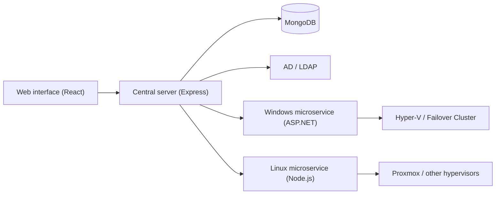

  

<h1 align="center">Project Osea</h1>

  A virtualization manager for shared infrastructure. 
  One control plane for Hyper-V and Proxmox, with strict isolation between tenants.

---

## What is Osea

Osea connects a central server to hypervisors (Hyper-V, Proxmox, and others) or to clusters (Hyper-V Failover Cluster, Proxmox cluster), and lets administrators and clients manage virtual machines from a web interface.

It is designed for semi-public setups such as a university cloud, where many teams share the same hardware and must never see or touch each other's VMs.

## How it works

The central server handles authentication, permissions, tenants and the audit log. It never talks to a hypervisor directly. It calls a microservice, and every microservice exposes the same REST API, described by a single OpenAPI contract.

There are two kinds of microservice:

- **Windows hypervisors** (Hyper-V, Failover Cluster) are handled by an ASP.NET service that uses WMI.
- **Every other hypervisor** (Proxmox to start with) is handled by a Node.js service running on Linux. For Proxmox it uses the REST API with API tokens.

Supporting a new hypervisor means writing one new microservice against the shared contract. The server and the web interface do not change.

## Access model

Osea has an admin interface and a client interface. Users sign in through Active Directory or LDAP, and their groups decide their role and the tenants they belong to.

- Every request is authorized on the server, per tenant. The web interface never makes that decision.
- Microservices can only be reached from the central server.
- Hypervisor credentials live in the microservices and nowhere else.
- Hypervisor-side permissions (Proxmox pools and ACLs, minimal WMI rights for Hyper-V) add a second barrier.

## Stack

| Part | Technology |
| --- | --- |
| Web interface | React (Vite), TypeScript, Tailwind CSS, shadcn/ui |
| Central server | Express, TypeScript |
| Windows microservice | ASP.NET Core, WMI |
| Linux microservice | Node.js, TypeScript |
| Database | MongoDB |
| Directory | Active Directory or LDAP |
| API contract | OpenAPI |

## Code principles

The codebase should be easy to read for a junior or intermediate developer, in the frontend as well as in the backend. No clever tricks, short functions, explicit names, and the same structure in every microservice.

Security is part of the same goal: inputs are validated, authorization is checked on every request, secrets stay out of the code, dependencies are scanned, and changes go through code review. Tenant isolation is covered by automated tests.

## Repositories

| Repository | Content |
| --- | --- |
| `osea-web` | Admin and client web interface |
| `osea-server` | Central server |
| `osea-contract` | OpenAPI contract shared by all microservices |
| `osea-service-windows` | ASP.NET microservice for Hyper-V and Failover Cluster |
| `osea-service-linux` | Node.js microservice for Proxmox and other hypervisors |

## Status

Osea is at an early stage. The architecture is defined and the next step is a proof of concept: the shared contract, one ASP.NET microservice and one Node.js microservice, each able to list and start a VM.

The planned phases are:

1. Proof of concept
2. MVP: unified inventory, basic VM actions, AD or LDAP sign-in, admin and client interfaces
3. Multi-tenancy: tenants, projects, quotas, audit log
4. Clusters: Failover Cluster, Proxmox cluster, VM console
5. Production: hardening, monitoring, documentation

## Contributing

Open an issue or a discussion in the relevant repository. A contribution guide will be added once the first repositories are public.

## License

See each repository.
